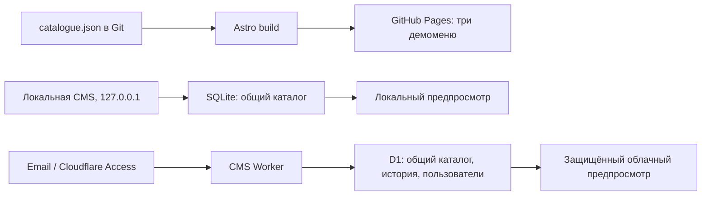
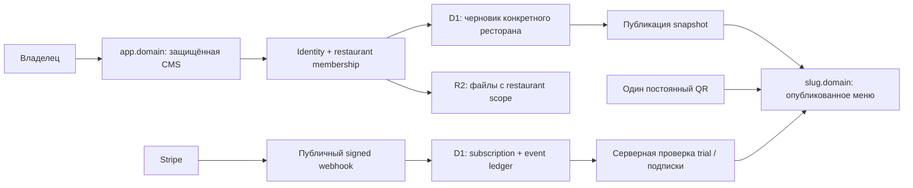

# Restaurant QR Menu SaaS — аудит MVP

Дата: 2026-11-08. Репозиторий: `girda/astro-portfolio`, ветка `main`, проверенный код `e0cc68a`. Требования: [PRODUCT_REQUIREMENTS.md](PRODUCT_REQUIREMENTS.md).

**Вывод: работающий прототип меню и CMS есть. Самостоятельный коммерческий SaaS для независимых ресторанов ещё не реализован.** Главное ограничение — одна общая база контента и глобальные роли, а не отдельные пространства заведений. Оплата не является последним недостающим переключателем: перед Stripe нужны границы ресторанов, публикация и постоянный публичный адрес.

Это аудит исходников, схем, маршрутов, сборки и автоматических тестов. Новые функции и исправления runtime не внесены. Cloudflare не публиковался, базы и настройки аккаунта не менялись. Состояние действующего облачного приложения может отличаться от локальной версии: последнее решение пользователя — оставить обновление CMS локально. DNS, Access policies, состояние удалённой D1 и фактическая версия production не сверялись через аккаунт. «Реализовано» ниже означает наличие проверяемого кода, а не подтверждение текущего production.

## Current Architecture

### Что работает сейчас

| Часть | Реализация и источник |
|---|---|
| Публичные меню | Astro, три оформления одного каталога: Street Food, Bunhafen (внутренний ID `diner`), Pizzeria. Общий [MenuPage](apps/streetfood/src/components/MenuPage.astro), [маршруты](apps/streetfood/src/pages/), [реестр оформлений](apps/streetfood/src/data/menu-options.mjs#L45). |
| Данные меню | Исходный [catalogue.json](apps/streetfood/src/data/catalogue.json), общий [контракт](apps/streetfood/src/data/catalogue-contract.mjs) и [адаптер представления](apps/streetfood/src/data/menu-view.mjs#L3). Данные уже отделены от визуального шаблона. |
| Локальная CMS | HTML/CSS/JS, Node 24, SQLite в `.local-data/menu.sqlite`; [store](apps/menu-cms/store.mjs#L11), [loopback-сервер](apps/menu-cms/server.mjs#L73). Это среда разработки без пользовательской авторизации. |
| Облачная CMS | Worker `hirda-menu-cms`, D1, статические assets, Cloudflare Access; [конфигурация](apps/menu-cms/cloud/wrangler.jsonc), [обработчик](apps/menu-cms/cloud/worker.mjs#L18). |
| Вход и пользователи | Проверка подписанного Access JWT и глобальные пользователи/роли; [auth](apps/menu-cms/cloud/auth.mjs#L12), [users](apps/menu-cms/cloud/users.mjs#L3). |
| Предпросмотр | CMS подставляет актуальный черновик в собранный HTML: [локально](apps/menu-cms/server.mjs#L49), [в Worker](apps/menu-cms/cloud/worker.mjs#L52). Облачный предпросмотр защищён входом. |
| Публичный деплой | [Общая сборка](scripts/build.mjs), [реестр приложений](scripts/projects.mjs), [GitHub Pages workflow](.github/workflows/deploy.yml). Публичное меню собирается из файлов репозитория. |

**Стрелки D1 → опубликованное меню пока нет.** Сохранение в CMS меняет черновик, но не `catalogue.json` в Git и не публичную сборку. В API есть чтение и сохранение, но нет операции публикации: [worker](apps/menu-cms/cloud/worker.mjs#L36), [сервер](apps/menu-cms/server.mjs#L27), [сборка](scripts/build.mjs).

### Поддерживает ли система независимые рестораны?

**Нет.** В [schema.sql](apps/menu-cms/cloud/schema.sql#L1) единственная запись `catalogue_state` ограничена `CHECK(id=1)`, история имеет глобальную ревизию. [Cloud store](apps/menu-cms/cloud/store.mjs#L8) читает `WHERE id=1`. В [миграции пользователей](apps/menu-cms/cloud/migrations/0002-users.sql) нет ресторанов и членства. [canWrite](apps/menu-cms/cloud/users.mjs#L4) проверяет глобальную роль, без принадлежности ресурса ресторану.

Поддомены тоже не реализованы в приложении: в [wrangler.jsonc](apps/menu-cms/cloud/wrangler.jsonc) нет маршрутов доменной зоны, а [worker](apps/menu-cms/cloud/worker.mjs#L20) требует авторизацию до определения пути и не выбирает ресторан по hostname. Поле URL в генераторе QR не настраивает DNS/SSL.

## Completed Features

Реализовано **для одного общего каталога**, не для нескольких клиентов:

| Функция | Доказательство / границы |
|---|---|
| Категории и блюда: создание, редактирование, цена, описание, порядок, скрытие | [Локальный store](apps/menu-cms/store.mjs#L69), [cloud store](apps/menu-cms/cloud/store.mjs#L26), [исключение скрытых записей из витрины](apps/streetfood/src/data/menu-view.mjs#L5). Удаление отдельно ниже. |
| Варианты блюда и аллергены | `variants`, `allergenIds`, `allergensVerified` проходят через [сохранение](apps/menu-cms/cloud/store.mjs#L34), [контракт](apps/streetfood/src/data/catalogue-contract.mjs), [адаптер](apps/streetfood/src/data/menu-view.mjs#L11). Это технические поля, не подтверждение состава владельцем. |
| Три оформления и общий источник данных | [MenuPage](apps/streetfood/src/components/MenuPage.astro), [реестр](apps/streetfood/src/data/menu-options.mjs#L47). |
| Настройки заголовка, подзаголовка, логотипа, режима и цен | [Редактор настроек](apps/menu-cms/public/admin.js#L420), [сохранение](apps/menu-cms/store.mjs#L34). Настройки не заменяют профиль ресторана и контакты. |
| История изменений, поиск, фильтры, сортировка и пагинация | [history-query](apps/menu-cms/history-query.mjs), [локальный запрос](apps/menu-cms/store.mjs#L61), [облачный запрос](apps/menu-cms/cloud/store.mjs#L18), [контролы](apps/menu-cms/public/admin.js#L410). |
| Защита от конфликтов редактирования | Ревизии и транзакции: [SQLite](apps/menu-cms/store.mjs#L74), [D1 batch](apps/menu-cms/cloud/store.mjs#L38). |
| Интерфейс CMS DE/EN/RU | [i18n.mjs](apps/menu-cms/public/i18n.mjs), немецкий по умолчанию, сохранение ручного выбора в браузере. Это язык админки, не перевод блюд. |
| Генерация и скачивание QR SVG/PNG | [qr-menu.js](apps/menu-cms/public/qr-menu.js#L11). Генерация работает; постоянство адреса ресторана пока отсутствует. |
| Серверные глобальные роли и управление статусом | [users](apps/menu-cms/cloud/users.mjs#L20): super-admin видит пользователей, меняет роли и pending/active/blocked, записывает событие, защищает владельца от блокировки. |

### Проверки, выполненные в этом аудите

| Команда | Результат и точный смысл |
|---|---|
| `npm test` | **97/97 passed**, весь репозиторий, не 97 тестов только CMS. Включает модули каталога, локальной CMS, облачной логики, истории, ролей, source checks; [команда](package.json), [тесты CMS](apps/menu-cms/tests/). |
| `npm run build` | Успешная общая сборка Astro-приложений. |
| `npm run check:public` | PASS, 59 HTML-страниц; заданные технические правила форм, шрифтов и хранения. |
| `npm run check:seo` | PASS для текущей публичной сборки портфолио. Не проверка будущих поддоменов SaaS. |
| `npm run check:legal` | PASS, 2 страницы / 52 включения футера. Проверка маршрутов и разметки, **не юридическое заключение**. |
| `npm run check:media` | PASS, 221 зарегистрированный asset / 5 notices. Проверка реестра, **не правовая экспертиза всех медиа**. |
| `node apps/menu-cms/cloud/build.mjs` | Успешная подготовка assets облачной CMS. |
| `wrangler deploy --config apps/menu-cms/cloud/wrangler.jsonc --dry-run` | Успешная упаковка Worker без публикации. Не проверка удалённой БД или Access login. |

Физические телефоны, 4K-монитор, новая визуальная регрессия, нагрузочный/penetration-тест, живой вход нового клиента, Stripe и DNS в этом аудите **не проверялись**. Историческая UI-проверка текущего этапа описана отдельно в [предыдущем отчёте](docs/audit/CMS_BRAND_LANGUAGES_2026-11-08.md); её нельзя выдавать за новый прогон. Моки облачных тестов не доказывают состояние production.

## Partially Implemented Features

| Требование | Статус / что не хватает |
|---|---|
| Email-регистрация и вход | Подписанный JWT проверяется; после входа [identify](apps/menu-cms/cloud/users.mjs#L7) создаёт pending/viewer, пользователь заполняет имя и ждёт одобрения. Но нет создания заведения, изолированного кабинета и проверенного полного пути нового внешнего клиента. Access policy задаётся вне Git. |
| Восстановление доступа | Повторный код на доступную почту может служить повторным входом. Потеря почты, её смена и поддержка восстановления не реализованы в [account flow](apps/menu-cms/cloud/public/cloud-shell.js) / [users API](apps/menu-cms/cloud/users.mjs#L14). Официальный механизм OTP: [Cloudflare](https://developers.cloudflare.com/cloudflare-one/integrations/identity-providers/one-time-pin/). |
| Удаление блюд/категорий | Скрытие есть. Физического удаления, корзины или архивирования с восстановлением нет: [API](apps/menu-cms/cloud/worker.mjs#L44) допускает только POST/PUT. |
| Фотографии | Выбор из готовой библиотеки; [cloud store](apps/menu-cms/cloud/store.mjs#L29) отклоняет другие изображения. [Загрузка логотипа](apps/menu-cms/public/admin.js#L427) не равна загрузке фотографий блюд. |
| Применение шаблона | [Выбор](apps/menu-cms/public/admin.js#L393) хранится в localStorage, открывает отдельный путь, не сохраняется как настройка ресторана на сервере. |
| Один постоянный QR | [buildMenuUrl](apps/streetfood/src/data/menu-options.mjs#L53) добавляет путь оформления к root. При смене темы меняется URL, ресторанной идентичности нет. Печать скачиваемого QR готова технически, сценарий SaaS — нет. |
| Обязательные сведения о блюдах | Есть справочник аллергенов, иконки и флаг проверки; [menu-options](apps/streetfood/src/data/menu-options.mjs#L20). Полнота немецких обязательных сведений и подтверждение реального состава — отдельная проверка, не результат валидации JSON. |
| Контакты и бренд ресторана | Часть оформления редактируется, но [MenuContacts](apps/streetfood/src/components/MenuContacts.astro#L3) содержит общие вымышленные контакты. Их нельзя предлагать гостям как реальные. |
| Эксплуатация | Есть Pages CI и [observability](apps/menu-cms/cloud/wrangler.jsonc). Нет подтверждённого цикла CMS staging → миграция → тест → deploy → rollback, восстановления из backup и настроенных оповещений. |

## Missing Features

Не найдены в схемах, API и продуктовых модулях CMS:

1. **Ресторан, владелец и членство**, изоляция каталога, настроек, истории, файлов, полномочий; основания: [schema](apps/menu-cms/cloud/schema.sql), [user migration](apps/menu-cms/cloud/migrations/0002-users.sql), [global store](apps/menu-cms/cloud/store.mjs#L8).
2. **Onboarding заведения**: название, slug, контакты, серверный template key, собственный кабинет; текущие [поля settings](apps/menu-cms/cloud/store.mjs#L34) этого не содержат.
3. **Публичный адрес ресторана**, маршрутизация поддоменов, разделение защищённой CMS и гостевого меню; текущий [Worker](apps/menu-cms/cloud/worker.mjs#L20) требует Access везде.
4. **Публикация и откат опубликованной версии**: нет draft/published модели и publish API; [schema](apps/menu-cms/cloud/schema.sql), [routes](apps/menu-cms/cloud/worker.mjs#L36).
5. **Хранилище загружаемых фото** с принадлежностью ресторану, ограничениями и обработкой; [image allowlist](apps/menu-cms/cloud/store.mjs#L29), [bindings](apps/menu-cms/cloud/wrangler.jsonc).
6. **Trial и подписки Stripe**: нет таблиц подписки/trial, Checkout, webhook, portal, entitlement-проверки или Stripe-зависимости; [schema](apps/menu-cms/cloud/schema.sql), [worker](apps/menu-cms/cloud/worker.mjs), [package.json](apps/menu-cms/package.json). Поиск scoped source не обнаружил отдельной реализации биллинга.
7. **Продуктовый немецкий лендинг и флаер для продаж SaaS**: текущие [приложения](scripts/projects.mjs) и [CMS](apps/menu-cms/public/index.html) не образуют этот самостоятельный путь продажи/регистрации.
8. **Процесс коммерческого запуска**: технические legal checks портфолио не подтверждают Gewerbe, налоги, условия SaaS, AVV, счета или договоры. См. [требования](PRODUCT_REQUIREMENTS.md#10-германия-юридические-требования); это внешние условия запуска, не заявление о правовом нарушении.

Заказы со столов, оплата еды, PDF AI, дополнительные тарифы и собственные домены клиентов **не являются недостающими блокерами MVP**: они сознательно отложены в ТЗ. Корзина в демонстрационном меню не считается настоящим ресторанным order backend: [menu.ts](apps/streetfood/src/scripts/menu.ts).

## Security Risks

| Приоритет | Риск и необходимое действие |
|---|---|
| **P0 — до доступа независимых клиентов** | Общий каталог: активный editor может редактировать общие данные. Это подтверждённое свойство прототипа, не обнаруженная утечка между существующими tenants — tenants пока нет. Нужны ресторанный scope и серверные проверки членства на каждом ресурсе. [users:4](apps/menu-cms/cloud/users.mjs#L4), [store:8](apps/menu-cms/cloud/store.mjs#L8). |
| **P0 — до публичных гостевых меню** | Нельзя просто отключить Access для `/preview/`: он показывает черновик. Публично читать только явно опубликованную версию соответствующего ресторана. [preview injection](apps/menu-cms/cloud/worker.mjs#L52). |
| **P1 — перед приёмом платежей** | У будущих Stripe webhooks должен быть отдельный точный маршрут без пользовательского Access, но с проверкой Stripe signature по raw body и защитой от повторной обработки. Сейчас [authorize](apps/menu-cms/cloud/worker.mjs#L20) выполняется раньше маршрутизации, а [readBody](apps/menu-cms/cloud/worker.mjs#L10) парсит JSON. См. [Stripe webhooks](https://docs.stripe.com/webhooks). |
| **P1 — перед клиентскими фото** | Изолированное файловое хранение, серверные MIME/size проверки, квоты, запрет выдачи произвольных файлов и права удаления. Сейчас [разрешена только библиотека](apps/menu-cms/cloud/store.mjs#L29); защиты будущей загрузки этим не реализованы. |
| **P1 — перед пилотом** | Проверить реальную Access policy для нового внешнего email, pending/approval/blocked и отзыв доступа. Repo JWT/role checks есть; настройки провайдера и live E2E здесь не подтверждены. [auth](apps/menu-cms/cloud/auth.mjs#L12), [worker](apps/menu-cms/cloud/worker.mjs#L26). |
| **P1 — данные клиентов** | Нужны процедура backup/restore с репетицией, правила хранения/удаления и аудит админских действий в контексте ресторана. Текущие [глобальные события](apps/menu-cms/cloud/migrations/0002-users.sql) и [первичный экспорт](apps/menu-cms/cloud/export-local.mjs) не заменяют полный recovery-процесс. |
| **P2 — перед открытым ростом** | Добавить прикладные лимиты на регистрации, каталоги, публикации, будущие uploads и billable операции. В [Worker](apps/menu-cms/cloud/worker.mjs) есть body limit, но нет ресторанных квот; это не означает отсутствия защит на стороне Cloudflare. |

Уже сделано полезное: [криптографическая JWT-проверка](apps/menu-cms/cloud/auth.mjs#L14), серверные роли, [source checks](apps/menu-cms/cloud/request-source.mjs), CSP/security headers, параметризованный SQL, [транзакционная история](apps/menu-cms/cloud/store.mjs#L40), экранирование JSON при HTML-вставке. Локальная CMS привязана к [127.0.0.1](apps/menu-cms/server.mjs#L73), проверяет Host/Origin. Нельзя превращать её в сетевую CMS простым туннелем без отдельной авторизации.

## Technical Debt

1. **Подтверждённый дефект переноса settings.** [export-local.mjs:7](apps/menu-cms/cloud/export-local.mjs#L7) экспортирует categories/products/extras, но пропускает settings из metadata, хотя [локальный store](apps/menu-cms/store.mjs#L47) их читает. При следующем первичном переносе можно потерять заголовок, логотип, режим и настройку цен. Исправить и покрыть round-trip тестом до переноса. В этом аудите экспорт не запускался.
2. **Два storage adapter с дублированием правил.** [SQLite save](apps/menu-cms/store.mjs#L69) и [D1 save](apps/menu-cms/cloud/store.mjs#L26) повторяют сборку полей/событий; контракт уже общий. Вынести небольшие чистые domain-операции и оставить отдельные транзакции адаптеров. Без универсального ORM ради ORM.
3. **Одна ревизия и JSON всего каталога.** [Cloud store](apps/menu-cms/cloud/store.mjs#L38) сохраняет общий snapshot; годится для маленького каталога, но не как глобальная блокировка всех ресторанов. Начать с snapshot/revision на ресторан. Нормализацию строк и полнотекстовый поиск вводить по измерениям.
4. **Лишние D1-обращения на assets.** [Worker](apps/menu-cms/cloud/worker.mjs#L26) вызывает [identify](apps/menu-cms/cloud/users.mjs#L10) до выдачи статических файлов: INSERT/условный UPDATE/SELECT. Перенести регистрацию/учёт входа в account/API flow, сохранив корректную проверку блокировки и отсутствие доступа к защищённым данным.
5. **Preview зависит от собранного HTML и клиентской подмены карточек.** [server](apps/menu-cms/server.mjs#L49), [preview-menu.ts](apps/streetfood/src/scripts/preview-menu.ts). Для публичных ресторанов нужен надёжный renderer опубликованного snapshot, без случайного seed-контента до загрузки.
6. **Выбор темы и QR локальны браузеру.** [appearance](apps/menu-cms/public/admin.js#L393), [QR](apps/menu-cms/public/qr-menu.js#L8). Перенести серверные ресторанные настройки, оставить браузеру только удобства интерфейса.
7. **Валюта зафиксирована.** [format-money.ts](apps/streetfood/src/data/format-money.ts#L1) использует EUR/de-DE, контракт — евроценты. Для Германии это рабочее начальное значение; добавить restaurant currency/locale и minor-unit форматирование, без механизма обмена валют.
8. **CMS не включена в полноценный deployment pipeline.** [Pages workflow](.github/workflows/deploy.yml) тестирует репозиторий и публикует сайты, но не делает CMS Worker build/dry-run и управляемые D1 migrations. Отдельный CMS QA/deploy job нужен до регулярных клиентских релизов; не публиковать сервер автоматически без согласованного процесса.

## MVP Launch Checklist

Готовность к демонстрации общего прототипа и готовность к самостоятельной работе клиентов — разные статусы.

- [x] Три визуальных шаблона и общий контракт данных.
- [x] Редактирование одного каталога, вариантов, аллергенов, истории.
- [x] Код проверки email-identity и глобальных пользователей/ролей.
- [x] Скачиваемый QR для вручную заданной ссылки.
- [x] Базовые тесты, сборка и упаковка Worker.
- [ ] Restaurant model + memberships + отрицательные тесты изоляции A/B.
- [ ] Создание заведения и полный внешний email onboarding/approval flow.
- [ ] Публичный ресторанный поддомен, DNS/SSL, постоянная ссылка.
- [ ] Draft → publish → guest view, откат опубликованной версии.
- [ ] Смена шаблона не меняет напечатанный QR.
- [ ] Загрузка фото и удаление/архивирование блюд.
- [ ] Настоящие контакты, цены, состав и проверенные владельцем аллергены пилотного заведения.
- [ ] Один серверный trial, политика окончания и хранения данных.
- [ ] Stripe test mode: подписка, webhook, повторы, failure/cancel, portal; затем live-настройки.
- [ ] Backup/restore rehearsal, наблюдаемость, минимальные квоты, регрессионный CI для CMS.
- [ ] Проверка guest/admin путей на телефоне, планшете, desktop/4K; гостям не нужен Access.
- [ ] Немецкая страница продукта и demo QR для продаж; флаер после утверждения цены.
- [ ] Отдельная проверка юридических/налоговых условий и договорных текстов SaaS.
- [ ] Пилот с отдельным рестораном, затем первые 5 платящих заведений.

Проверка безопасности выше — обзор кода, а не сертификация. До реальных гостей демоданные заменяются сведениями владельца; демонстрационная корзина не должна обещать фактический приём заказа.

## Recommended Implementation Order

### Этап 1 — отдельное пространство ресторана (первый конкретный этап)

**Цель:** владелец A редактирует только ресторан A, владелец B — только B. Сохранить существующий дизайн, три шаблона и данные текущего прототипа.

- Добавить рестораны и членство, отдельный platform super-admin и роли внутри ресторана.
- Текущий singleton перенести в один внутренний demo-ресторан; не назначать всем старым editor право на все рестораны.
- Сделать все операции каталога, settings и history scoped к ресторану; tenant определяется из проверенного контекста, клиентский ID сам по себе не даёт права.
- Создание ресторана: название, уникальный зарезервированный slug, начальные settings. Выбор текущего ресторана в CMS.
- Адаптировать local/D1 store без полного переписывания меню; сохранить импорт settings.
- Приёмка: A не читает/не изменяет B через подмену URL/ID; B не видит историю/настройки A; viewer не пишет; blocked не входит в данные; миграция сохраняет контент и settings; два ресторана редактируются независимо.

Основание этапа: [singleton schema](apps/menu-cms/cloud/schema.sql), [глобальный ACL](apps/menu-cms/cloud/users.mjs#L3). До согласования этого этапа изменения не начаты.

### Этап 2 — публичное меню, публикация и QR

Стабильный `${slug}.platform-domain/`, отдельная защищённая CMS, версия draft/published, atomic publish, серверная тема, контакты ресторана. QR указывает на корень ресторана, не на файл темы. Проверить DNS/TLS и гостевой доступ без входа. Cloudflare поддерживает маршрутизацию в доменной зоне, но её нужно настроить и проверить: [Routes](https://developers.cloudflare.com/workers/configuration/routing/routes/).

### Этап 3 — завершить самостоятельное наполнение

Фото uploads, архивирование/удаление, preview до публикации, проверка состава и аллергенов, компактный onboarding. Тест реального внешнего email и политика approval. Это завершает путь «владелец сам собрал меню» на базе существующих форм.

### Этап 4 — trial и Stripe

Согласовать начало трёх дней и политику ограничений. Для первого пилота предлагается внутренний 72-часовой trial без карты, после него Checkout. Это **предложение**, не реализованная функция и не единственно допустимый вариант: Stripe также поддерживает trial без платёжного метода с выбранным поведением окончания — [Trials](https://docs.stripe.com/billing/subscriptions/trials).

Сначала привязать billing account к ресторану; затем Checkout, signed webhooks, ledger обработанных events, серверный entitlement и Customer Portal. Не давать доступ по `success_url`. Проверить async lifecycle, просрочку, повторы, cancellation и восстановление после оплаты: [Subscription webhooks](https://docs.stripe.com/billing/subscriptions/webhooks), [Webhook verification](https://docs.stripe.com/webhooks), [Customer Portal](https://docs.stripe.com/customer-management). Не начинать с оплаты еды — её нет в MVP.

### Этап 5 — ограниченный коммерческий пилот

CMS QA/deploy + миграции и восстановление, юридическая проверка, простой немецкий лендинг, флаер, один ресторан с подтверждёнными данными. Затем 5 платящих клиентов. Первые продажи не требуют AI-импорта, десятка тарифов или отдельного приложения на каждого клиента.

## Future Scaling Considerations

**Предлагаемая минимальная архитектура; ниже не описание уже сделанного.** Сохранить Astro templates + Workers/D1. Не вводить микросервисы и отдельную базу/Worker для каждого кафе без реальной необходимости.

Минимальные сущности (проект схемы, не готовая миграция):

| Сущность | Назначение |
|---|---|
| `restaurants` | ID, уникальный slug, name, template_key, locale, currency, контакты, published_revision; trial timestamps при выборе внутреннего trial. |
| `restaurant_memberships` | user_id + restaurant_id + role; глобальная роль платформы хранится отдельно. |
| `catalogue_drafts` | restaurant_id как ключ, revision, JSON существующего контракта. |
| `menu_versions` | restaurant_id + version, immutable snapshot; указатель опубликованной версии обновляется атомарно. |
| `catalogue_history` | restaurant_id + revision, автор и изменение; tenant-prefixed индексы. |
| `media` | restaurant_id, безопасный object key, MIME/size и права; object prefix назначает сервер. |
| `billing_accounts` / `webhook_events` | связь tenant ↔ Stripe customer/subscription, уникальный event_id, серверный статус и обработка повторов. |

- Hostname сопоставлять с известным рестораном на сервере. Public API, история, файлы и cache keys всегда учитывают tenant. Кэшировать только опубликованные версии по tenant + version.
- Access можно сохранить для пилота за отдельным identity adapter; до массового использования проверить реальный клиентский flow, ограничения и условия сервиса. Сейчас нет оснований переписывать auth вслепую.
- [R2](https://developers.cloudflare.com/r2/) — возможное файловое хранилище, пока не подключено. [D1 Time Travel](https://developers.cloudflare.com/d1/reference/time-travel/) — инструмент восстановления, но наличие сервиса не доказывает готовность процесса: нужны retention policy, резервные копии файлов и репетиция восстановления.
- Деньги хранить в целых minor units, валюту/locale задавать конфигурацией ресторана. Налоги SaaS-подписки и цены блюд разделить; не строить международный налоговый движок в MVP.
- Для роста сначала tenant-scoped запросы/индексы и лимиты, затем измерения. SQL-нормализацию, FTS и очереди добавлять под реальную нагрузку, а не ради будущих тысяч ресторанов.
- Переводы меню, table QR, реальные заказы/оплата еды, AI PDF, premium themes, custom customer domains и расширенная аналитика остаются после MVP согласно [требованиям](PRODUCT_REQUIREMENTS.md).
