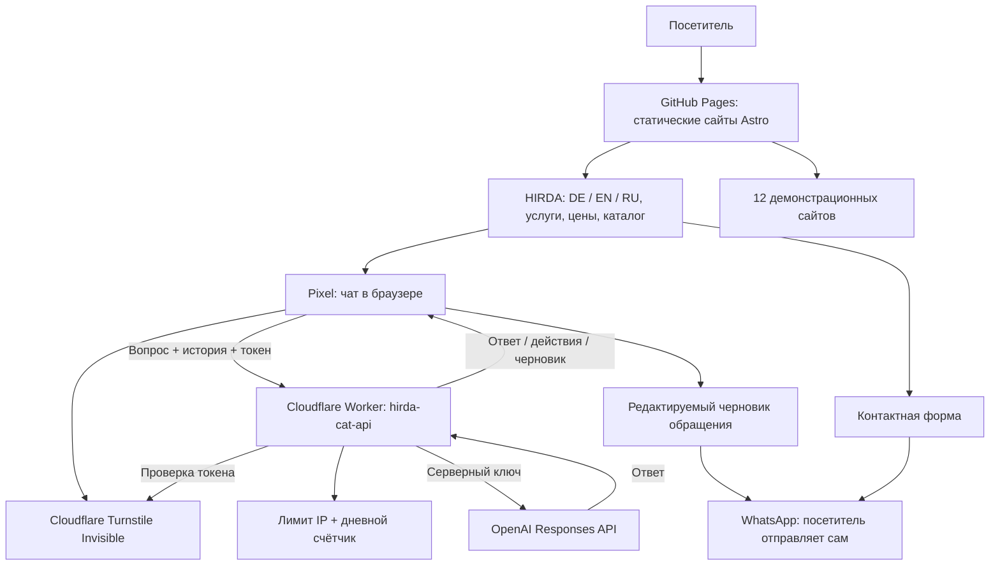
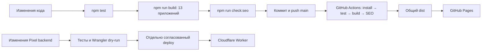
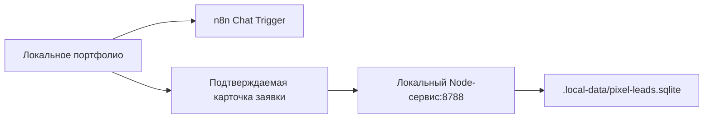

# Архитектура HIRDA — фактическое состояние

Обновлено 29.10.2026 по исходникам, конфигурации CI и публичной проверке Pixel. Это карта текущей системы; будущие модули отдельно. Обновляем при изменении app, API или способа публикации.

## Что видит посетитель

Публичный адрес: https://girda.github.io/astro-portfolio/. API: `hirda-cat-api.hirda-assistant-api.workers.dev/api/chat`. Секреты находятся на сервере. Сайт не отправляет WhatsApp-сообщения самостоятельно. Демокорзина Pixel не отправляет заказ на кухню и не принимает оплату.

## Состав монорепозитория

| Часть | Папка | Назначение |
|---|---|---|
| HIRDA | apps/portfolio | Портфолио на трёх языках, каталог с фильтрами и пагинацией, Pixel, контакт |
| Lindenhof | apps/lindenhof | Каталог авто, фильтры, сравнение, страницы моделей |
| Falkenried | apps/hausbau | Каталог домов, фильтры/сортировка, сравнение, планы |
| Eichenhain | apps/ecohomes | Экодома, страницы домов, энергосхема, контакты |
| KANT | apps/barbershop | Барбершоп |
| KLAR | apps/cleaning | Клининг и калькулятор |
| WERKRAUM | apps/autoservice | Автомастерская |
| STILL | apps/nails | Beauty & Spa |
| Хлібний / немецкая версия | apps/khlibnyi | Сайт пекарни / кафе |
| Street Food | apps/streetfood | Меню, категории, поиск, локальная корзина |
| STROMWERK | apps/electrical | Электрик |
| HAUSWERK | apps/homeservice | Домашние мастера |
| GRÜNWERK | apps/gardens | Садовые работы |
| Общие элементы | packages/ui | Компоненты, иконки, стили и движение |
| Pixel backend | apps/assistant-api | Worker, инструкции, проверки, локальные сервисы |

Состав общей сборки задаёт `scripts/projects.mjs`: 13 приложений, включая портфолио. `/lab/` и `/cat-lab/` — экспериментальные маршруты портфолио; `apps/vyra` не включён в общую сборку. Наличие папки не означает публикацию.

## Публикация и проверки

Push публикует фронтенд через `.github/workflows/deploy.yml`. Worker этим workflow не публикуется. Внешние уведомления CI отложены; результаты доступны в GitHub Actions. Сборка сначала готовит временный каталог, чтобы ошибка одного app не уничтожила последнюю рабочую сборку.

## Где находятся данные

- Контент сайтов, цены и каталог проектов — файлы в репозитории. CMS пока нет.
- Публичный Pixel передаёт ограниченную историю диалога серверу; Worker обращается к OpenAI с `store: false`. Это не обещание отсутствия служебного хранения у провайдера.
- Дневной счётчик — Cloudflare Durable Object с SQLite. Это **счётчик запросов, не база клиентских заявок**. Сейчас настроены 200 запросов в сутки и 10 за минуту на IP; денежный баланс он не измеряет.
- Публичной CRM, базы заказов, оплаты и интеграции с кухней нет. Черновик WhatsApp проверяет и отправляет посетитель.
- Локальный n8n и база заявок работают отдельным путём разработки:

UUID n8n сохраняется в sessionStorage. Node проверяет поля и токен черновика, исключает повторную запись через UNIQUE draft_id. Старые записи таблицы n8n не синхронизируются с SQLite. Эти компоненты не опубликованы вместе с GitHub Pages.

## Как расти после MVP

Клиентские сайты — отдельные deploy/домены и изолированные доступы. Общие компоненты переиспользуем по необходимости. Первое предлагаемое расширение: CMS для Street Food (блюда, цены, фото, аллергены, доступность, публикация, QR-ссылка). Хранилище, авторизация и интеграции ещё требуют согласования. Платежи и реальные заказы — отдельный этап.

## Текущие ограничения

29.10 публично проверены кафе, черновик мастера и редактирование обращения. В автосалоне выявлено нарушение бюджета; исправление инструкций подготовлено, публикация и повторная проверка ожидают восстановления входа Cloudflare. Полная готовность сценария пока не заявляется. Подробности: [проверка Pixel](audit/pixel-scenarios-2026-10-29.md), [план MVP](MVP_LAUNCH.md).
