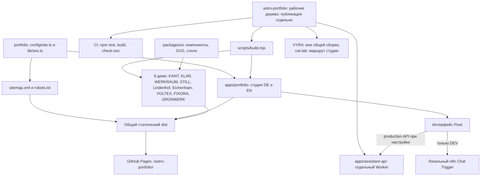
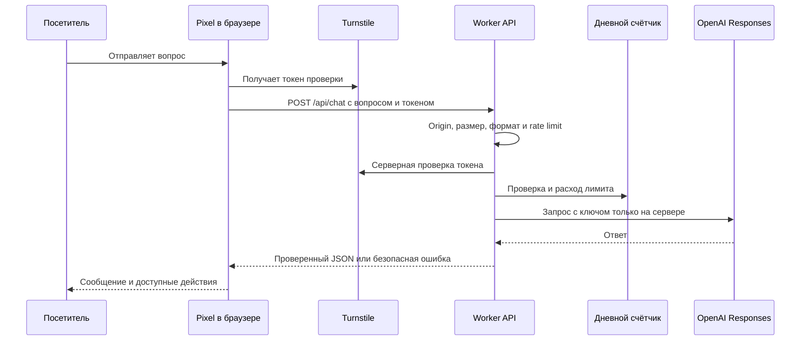
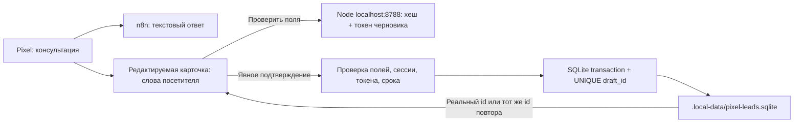
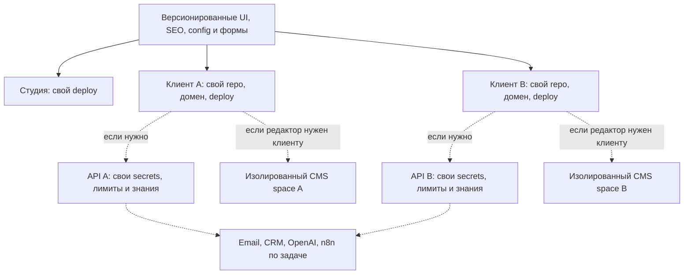

# Карта архитектуры HIRDA

Обновлено 24.10.2026 по рабочему дереву. **Сплошные связи ниже — текущая реализация; будущая архитектура вынесена отдельно.** Схемы не синхронизируются автоматически: обновляем при изменении модулей, маршрутов, API и деплоя. На GitHub Mermaid отображается диаграммой.

## 1. Как всё устроено сейчас

Локально собираются 10 сайтов (портфолио и 9 демо). Публичная версия отдельно; новые локальные изменения этой задачи не публиковались. Незакоммиченные файлы не означают, что они уже есть на GitHub/CI.

## 2. Карта существующих проектов

| Проект | Код | Данные/логика | Связь с сервером |
|---|---|---|---|
| HIRDA | `apps/portfolio` | `src/data`, `i18n`, config; секции в components | Pixel → API; контакт → подготовленный WhatsApp |
| KANT | `apps/barbershop` | `data/site.ts`, `contact.ts`; Embla/диалоги/FAQ | Демо, не настоящая запись |
| KLAR | `apps/cleaning` | `data/site.ts`, калькулятор | Демо |
| WERKRAUM | `apps/autoservice` | `data/site.ts`, DE/RU, ServicePage | Демо-запрос |
| STILL | `apps/nails` | локали и данные,4 страницы ×3 языка | Демо-запрос |
| Lindenhof | `apps/lindenhof` | авто в data, фильтры/сравнение в scripts | Демо, не реальный inventory API |
| Eichenhain | `apps/ecohomes` | подбор домов/энергии и формы | Демо |
| Pixel API | `apps/assistant-api` | validate, knowledge, scenarios, budget | OpenAI Responses, Turnstile, Durable Object |
| VOLTEX | `apps/electrical` | `data/site.ts`, TradePage, electrical theme | Локальная demo-сводка |
| FIXORA | `apps/homeservice` | `data/site.ts`, TradePage, homeservice theme | Локальная demo-сводка |
| GRÜNWERK | `apps/gardens` | `data/site.ts`, TradePage, фильтр идей | Локальная demo-сводка |
| Restaurant | Ещё нет отдельного app | Сценарий кафе в Pixel не является сайтом ресторана | Не реализовано |

## 3. Pixel: текущий публичный путь

Production-доступность конкретного Worker и secret-конфигурация в аудите не проверялись платным запросом. UI и backend существуют; это не гарантия доступности24/7. Общий бюджет — число запросов, не точный лимит евро.

В DEV может использоваться n8n вместо Worker: браузер отправляет `{ action: 'sendMessage', sessionId, chatInput }`; UUID хранится в sessionStorage. Окружения не должны смешиваться. Контактная форма пока открывает WhatsApp — не отправляет email.

## Локальные заявки Pixel — этап 24.10.2026

Сервис и форма реализованы и проверены локально. **24.10.2026 применён локальный Publish: прямой Save Lead у модели отключён; активный чат и сохранение id=3 проверены.** Старая таблица HIRDA Leads сохранена и не синхронизируется с новой SQLite. Production Worker не менялся. [Подробности и ограничения](audit/pixel-confirmation-2026-10-24.md).

## 4. Направление роста, согласованное пользователем

Это целевая схема, ещё не текущая система. Сначала Astro и небольшие изменения, затем модули по потребности. Next.js — только для приложения, которому действительно нужны его server features. Не нужен общий монолит или обязательный VPS для20 статических сайтов.

## Что обновлять вместе со схемой

Добавление app → таблица проектов + build/deploy. Новая интеграция → API-схема + границы данных. Новый клиент → отдельный repo/deploy/access, не секреты в этой документации. Архитектурное решение → `ARCHITECTURE_PROPOSAL.md` либо отдельный ADR с датой и причиной.

## SEO-основа PR-01

Реализована локально23.10.2026: единые canonical и DE/EN alternate, noindex для cat-lab и preview, sitemap только для зарегистрированных страниц. При размещении в подкаталоге robots.txt не задаёт правила для всего чужого host; фактический noindex находится в HTML. Проверки добавлены в CI, но удалённый workflow не запускался — push не выполнялся. Инструкции: [DEPLOYMENT.md](DEPLOYMENT.md).

## Сервисные демо — 24.10.2026

`packages/ui/TradePage.astro` принимает типизированный `TradeSite`; данные бизнеса — `apps/<app>/src/data/site.ts`. `ServiceQuote.astro` управляет локальной формой. Общая база `service-base.css`, отраслевые темы `trade-themes.css`; они не импортируют прежний foundations.css, чтобы не перебивать согласованный дизайн. KLAR использует `purehaven.css` и сохранённый калькулятор. Цвета темы — CSS custom properties в одном месте. [QA и Figma](audit/service-demos-2026-10-24.md).
