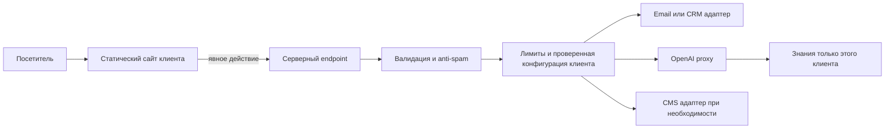

# Архитектура веб-студии: предложение ADR-001

Дата23.10.2026. Статус: направление A→B-lite одобрено пользователем23.10.2026; детали инфраструктуры не утверждены. Никакой перенос домена/сервисов или миграция стека не выполнялись.

## Цель и принципы

Довести студию до продаж и обслуживать10–20 клиентских сайтов без общего монолита. Нужны независимые релизы, доступы, контент, расходы и восстановление. Общий дизайн-код переиспользуется, но клиентские данные/секреты не смешиваются. Статические сайты остаются статическими; динамика появляется только для конкретной задачи.

## Вариант A — минимальные изменения текущего репозитория

Оставить `apps/portfolio`, существующие демо и root build; сайт студии расширять маршрутами. Использовать существующий `packages/ui` и добавить небольшой typed site config/SEO helper. API оставить отдельно. Для первого клиента — отдельный repo/deploy из подготовленного шаблона, а не новый subpath общего Pages artifact.

Плюсы: низкий риск, короткий путь к работающему результату, нет миграции зависимостей, сохраняются URL и существующая CI. Минусы: ручная синхронизация шаблонов/lockfiles, root build демо связан, raw relative imports shared UI, нет политики версий компонентов.

Затраты: на старте новых обязательных сервисов нет; основной расход — труд на ручные обновления. Домен, email/API и возможная CMS считаются отдельно. Нельзя считать бесплатный Pages универсальным коммерческим хостингом клиентов. Подходит для запуска студии и1–3 продаж.

## Вариант B — умеренно модульная студия, независимые клиенты

Внутренний repo студии содержит маркетинговый сайт, демо, библиотеку и API. После первого production-клиента оформить npm workspaces (либо pnpm после отдельной оценки), зависимости/версии и отдельные build targets. Сразу Turborepo не нужен: вводить при измеримой проблеме времени сборок/CI.

```text
astro-portfolio/                         # внутренний studio repo
  apps/
    portfolio/                          # имя сохраняем; содержание студии
    barbershop/ cleaning/ ...            # существующие демо
    handwerk/                           # после P0
    restaurant/                         # после Handwerk
    assistant-api/                      # отдельный deploy
  packages/
    ui/                                 # существующие базовые компоненты
    site-config/                        # BusinessProfile + Theme + FeatureFlags
    seo/                                # URL/metadata/index policy
    forms/                              # контракты/валидация (по потребности)
    studio-content/                     # подтверждённые услуги/цены/кейсы для сайта и Pixel
  docs/

client-<slug>/                          # отдельный repo клиента
  src/ public/ content/
  site.config.ts
  package.json                          # версии studio packages фиксированы
  deployment config + own CI
  env.example                           # без значений секретов
```

`packages/*` вводить по одному при реальном повторном использовании, не создавать пять пустых abstractions. Общий пакет публиковать версионированно либо поставлять зафиксированным template snapshot; не привязывать клиента к незакоммиченным файлам на Mac. Обновления через PR + preview и собственные тесты клиента, без автоматического обновления всех сайтов разом.

Плюсы: изоляция сбоев и аккаунтов, переносимость, контролируемые обновления, отдельные preview/domain/backup. Минусы: больше CI/репозиториев, нужна дисциплина release notes и проверки совместимости; инфраструктурный overhead выше вариантаA. Нельзя оценить цену поддержки только количеством сайтов — учитывать частоту контентных изменений, CMS и интеграции.

## Рекомендация

**Сейчас A, с поэтапным переходом к B.** Называть это «B-lite»: не меняем Astro/роуты/имена папок; сначала улучшаем студию и SEO, затем Handwerk как первый эталон конфигурируемого сайта. Отдельный клиент получает независимый repo/deploy с первого заказа. Повторный обзор на5–10 клиентах. Старые демо не обязаны все использовать один layout: унифицируются контракты, UX-примитивы и проверки, а не индивидуальный визуальный стиль.

Next.js — вариант только для нового приложения с необходимыми SSR/auth/personal cabinet/server features. Он не требуется для обычного сайта с формой или AI proxy и не заменяет tenant isolation. Не переносить работающие демо ради унификации фреймворка.

## Контент и тема

Business config: id/brand, подтверждённые контакты/география, locale, услуги/пакеты, ссылки, статус demo/client, индексируемость, features. Schema validation при сборке; секреты не входят в config. Theme отдельно: семантические цвета/типографика/spacing/radii/motion. Handwerk сначала одна Nature-тема, Industry/Clean позже как варианты, не три одновременных проекта.

SEO metadata получают реальный pathname, locale, canonical origin/base, title/description/social image, noindex. Sitemap генерируется из разрешённых индексируемых routes. Демо-контент не попадает в реальные отзывы/ratings schema.

## Hosting и стоимость эксплуатации

| Часть | На старте | Рост |
|---|---|---|
| Студия/демо | Сохранить текущий deploy до выбора домена; подготовить static output | Cloudflare Workers Static Assets — кандидат для коммерческой студии |
| Клиентский сайт | Свой static deploy/domain, аккаунт/ownership понятен | Независимый CI и rollback; не один большой deploy20 сайтов |
| AI/формы | Отдельный serverless endpoint | Отдельные deployments/secrets/лимиты клиента; shared gateway только при выгоде |
| CMS | Git/content файлы по умолчанию | Headless CMS по частоте правок и ролям, isolated space/project |
| n8n/долгоживущие задачи | Не вводить без задачи | Managed n8n либо обслуживаемый EU VPS с backup/restore/patching |

По проверенной документации Cloudflare статические запросы Static Assets бесплатны; CPU/functions/storage/build limits и платные функции считаются отдельно. Платный Workers plan имеет базовую подписку$5/месяц, но это НЕ итоговая цена на20 клиентов и не включает OpenAI, домены, почту/CMS, хранение и труд. Проверять тариф/eligibility/лимиты в момент выбора. Vercel Hobby — только некоммерческое личное использование; для выбранных коммерческих Next.js-проектов рассматривать подходящий платный план. Существующие GitHub Pages URL сохраняем, но не планируем всю коммерческую студию как бесплатный online business на Pages.

Формула бюджета: домены + static/build + functions + email + AI tokens + storage/CMS + backups + support hours. До реальных нагрузок оценка точного «€/клиента» будет ложной точностью. Операционная цель — минимум постоянных серверов и платных сервисов до первых продаж.

## Формы, backend и AI



Не доверять tenant_id из браузера как разрешению. Origin/host проверяются, но не заменяют аутентификацию и серверную авторизацию. Админ-функции требуют auth/RBAC. Для публичного чата — серверное сопоставление сайта/конфига, anti-abuse, лимиты токенов/вызовов/затрат; ключи только server-side. Разделение знаний, secrets и storage клиентов; audit events без полного текста переписки по умолчанию. Для действий в CRM/календаре — узкий allowlist инструментов, подтверждение критических действий и idempotency. Никакой модели прямого доступа ко всем клиентским БД.

CMS выбирать после content model/частоты публикаций/ролей/экспорта/region/backup. Не поднимать Strapi+DB на каждый лендинг. Backend/API knowledge не должны импортировать данные из случайной папки приложения: общий маленький content package/версионированный export.

## Миграция без потерь

1. Сохранить инвентарь рабочего дерева и исходные материалы, проверить существующие13 тестов.
2. SEO foundation без смены routes/deploy.
3. Согласовать студию в desktop/mobile и внедрить малыми шагами; не отключать Pixel.
4. Добавить проверенные config/контракты при создании Handwerk.
5. Первый client template → отдельный repo/deploy, зафиксированные зависимости, документы владения/экспорта.
6. Извлечь реально повторяемые modules, оформить workspace и independent builds.
7. CMS/lead backend/multi-tenant gateway только по запросам клиентов.

Риск миграцииA низкий при тестах путей; B средний из-за packaging/relative imports/CI. Каждая миграция — отдельный diff с rollback. Домен, юридические сведения, канал заявки и тарифы студии требуют подтверждённых данных до коммерческой публикации.
