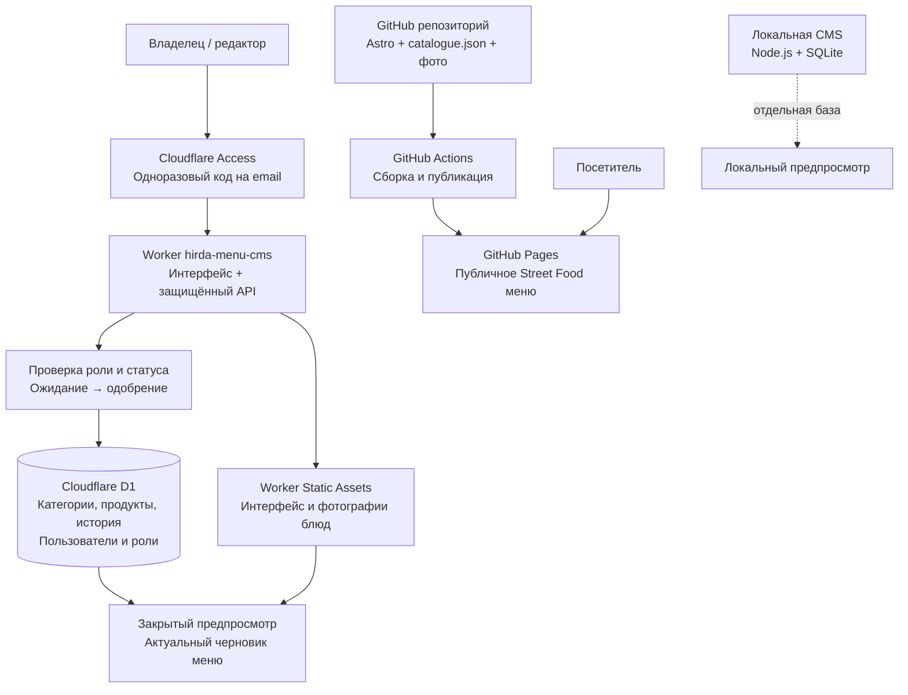

# My Menu — текущая архитектура

Проверено 7 ноября 2026. Вход владельца подтверждён пользователем 6 ноября.

## Где лежит код и данные

- `apps/menu-cms/public/`: редактор категорий/продуктов, журнал, CSS и диалоги.
- `apps/menu-cms/cloud/public/`: профиль, регистрация и управление пользователями.
- `apps/menu-cms/cloud/worker.mjs`: сетевые маршруты, права, выдача предпросмотра.
- `apps/menu-cms/cloud/auth.mjs`: проверка подписанного Cloudflare JWT.
- `apps/menu-cms/cloud/users.mjs`: роли, одобрение, профиль и журнал изменения доступа.
- `apps/menu-cms/cloud/store.mjs`: D1, версии каталога и история изменений.
- `apps/menu-cms/cloud/build.mjs`: сборка закрытого интерфейса и меню в `.cloud-assets`.
- `apps/menu-cms/server.mjs`, `store.mjs`: отдельный локальный сервер и SQLite.
- `apps/menu-cms/.local-data/`: локальная база и резервная копия; не в Git.
- `apps/streetfood/`: Astro-сайт меню; исходный каталог в `src/data/catalogue.json`, фотографии в `public/assets/menu/`.
- `apps/portfolio/`: портфолио, карточка и ссылка на публичное меню.

## Существенные границы

Сохранение в D1 меняет закрытый черновик и его предпросмотр, но НЕ публикует изменения на GitHub Pages.
Локальная SQLite и D1 не синхронизируются автоматически. Cloudflare Access подтверждает email;
сервер CMS отдельно разрешает просмотр/редактирование по роли и статусу.
Сейчас существует один общий каталог, а не изолированная CMS для многих заведений.

## Следующий этап — ещё не реализован

Выбор оформлений меню и их скриншоты; вкладка QR; сохранение публичного адреса;
проверка подключения собственного домена. QR должен вести на публичное меню, а не закрытый предпросмотр.
Модель отдельных каталогов или общего каталога для шаблонов требует выбора пользователя.
