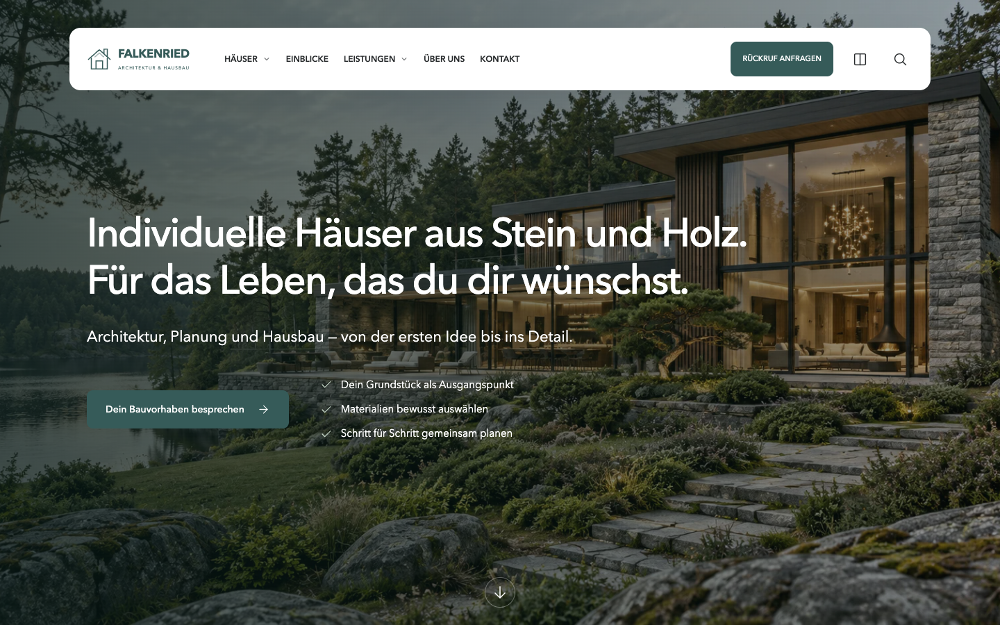
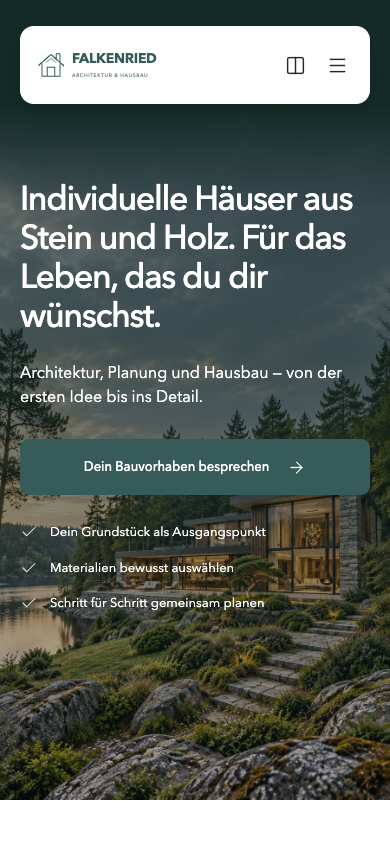
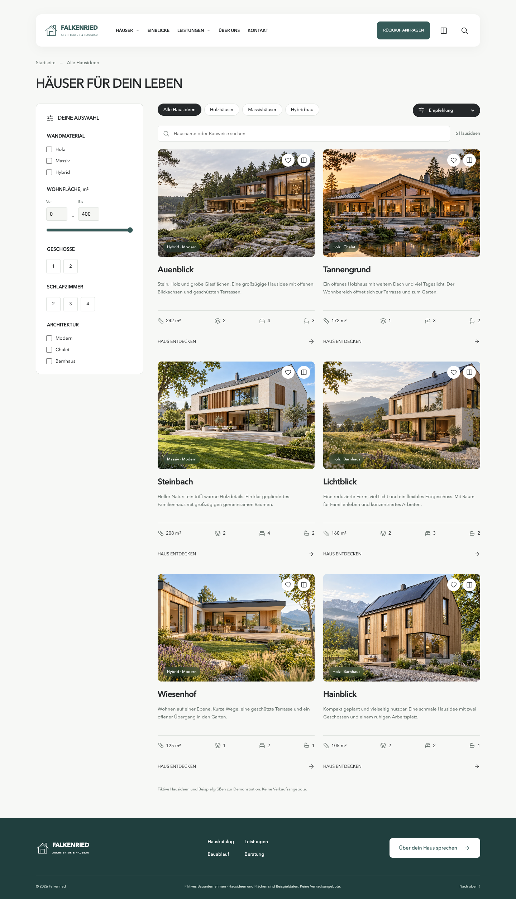

# Falkenried / Eichenhain — 27.10.2026

Статус: на проверке у Артёма, локально. Новая немецкая марка согласована. Оригинальный референс изучен на desktop/mobile, включая каталог; собственные фотографии и тексты вместо контента оригинального застройщика.

## Реализация

Falkenried: главная, каталог шести моделей, шесть detail-страниц. Фильтры материалов, площади, этажности, спален, архитектуры и крыши; поиск, числовая сортировка, счётчик/пустой результат/сброс, URL-состояние. Избранное, сравнение до трёх моделей, четырёхшаговый подбор, адаптивное меню и фильтр, локальная подготовка обращения. GSAP с reduced-motion. Новые portrait/desktop изображения.

Eichenhain: сравнение трёх домов, дневной/ночной режим энергосхемы, фильтр площади в подборе, учёт стадии проекта и перенос пожеланий в форму; плавное GSAP-появление.

Portfolio: Falkenried второй, Eichenhain последний, JSON порядка, DE/EN/RU подписи и три превью на каждый сайт. Состав установки/CI берётся из общего реестра приложений.

## Проверки

- Пройдено: 35 Node-тестов, build всех 11 приложений, check:seo и git diff --check.
- Пройдено: эмуляция 320/390/768/1024/1440 px, главная/каталог/detail; нет горизонтального overflow, hero CTA доступна. На реальных устройствах не проверено.
- Пройдено: совместные фильтры, сортировка площади, поиск без результатов и сброс, mobile drawer/возврат overflow, сравнение, смена этажа, четыре шага подбора, форма/редактирование/повторное открытие. Ошибок JS в проверенных сценариях нет.
- Пройдено: Eichenhain night/day, сравнение двух моделей, площадь и стадия с переносом в форму; reduced-motion Falkenried.
- Исправлено при QA: изображения карточек получали HTML-height вместо адаптивной высоты; повторное открытие результата подбора; cleanup завершённых GSAP tweens; пробелы при скрытом переносе строк на mobile.
- SEO: демонстрации noindex, canonical и OG присутствуют, localhost и DEV-capture не включаются в production.
- Не настроены: отдельные lint/full typecheck; build не выдаётся за typecheck. Lighthouse/CWV не измерялись.
- Формы не отправляют сообщения. Планировки условные. Показатели домов — демонстрационные, не предложения продажи.

## Макеты

[Falkenried desktop](https://www.figma.com/design/rFe5BO7jxtv9upJk9z35C5/?node-id=22-2), [каталог](https://www.figma.com/design/rFe5BO7jxtv9upJk9z35C5/?node-id=22-492), [mobile](https://www.figma.com/design/rFe5BO7jxtv9upJk9z35C5/?node-id=22-1077). Нативные редактируемые слои, Arimo в Figma. Eichenhain: обновлены hero-заголовки и добавлен переключатель Tag/Nacht; остальные новые динамические состояния не разложены отдельными экранами.

Портфолио в Figma: в существующие desktop/mobile сетки добавлены карточки Falkenried второй и Eichenhain последней с актуальными тремя превью. Прежний файл содержал только пять других карточек; его полный редизайн не выполнялся.

## Доказательства

Локально: http://localhost:4332/ и http://localhost:4332/katalog/. Общая сборка: http://127.0.0.1:8762/astro-portfolio/demos/hausbau/.

[Как менять порядок](../PROJECT_ORDER.md).
