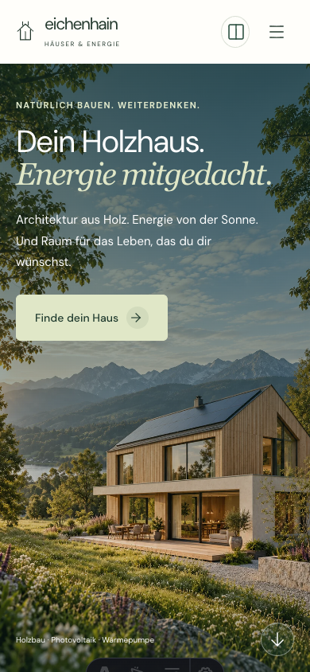
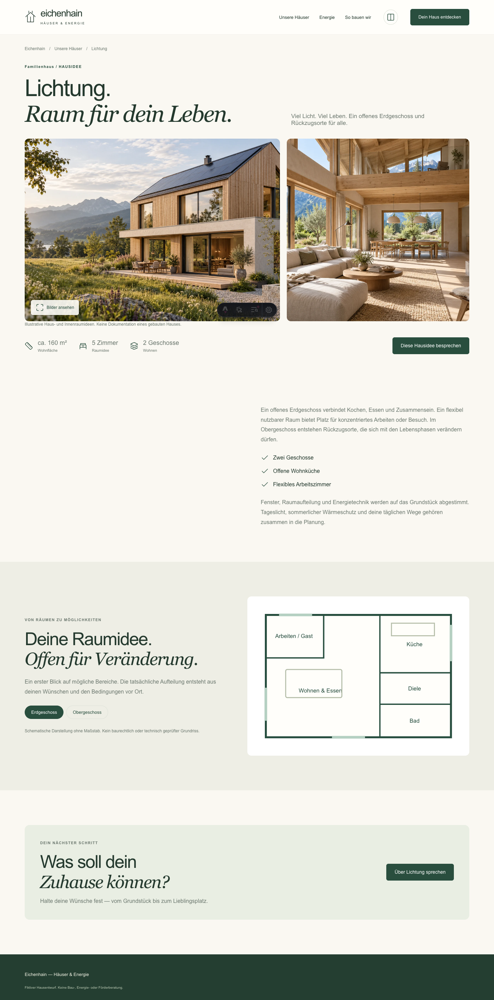

# Доработка Falkenried и Eichenhain — 27.10.2026

Статус: локально, на проверке у Артёма. Push/публикация не выполнялись.

## Falkenried

Два самостоятельных горизонтальных слайдера по шесть домов. Отступы, боковые поля, кнопки навигации с доступными названиями, клавиатурные стрелки и отключение недоступного направления. В первом — компактные превью, во втором — карточки с описанием, характеристиками, избранным и сравнением. Стрелки основных кнопок действий убраны, подписи центрированы. Общий TooltipLayer даёт подсказки на hover/focus и закрывается при Escape, клике или скролле.

Раздел «FALKENRIED. GUT DURCHDACHT.» заменён на фотографию и три понятных этапа подхода. «HÄUSER. RÄUME. MÖGLICHKEITEN.» заменён на подробную витрину «Welches Haus fühlt sich nach dir an?». Каталог, подбор и сравнение сохранены.

## Eichenhain

Полноэкранный hero с читаемой подложкой, отдельной portrait-фотографией для телефона и анимированной стрелкой (reduced motion соблюдён). Удалена конфликтующая мобильная раскладка из shared mobile-heroes только для этого приложения. Карточки компактнее; переходы на три новые страницы `/haeuser/lichtung/`, `/haeuser/wiesenblick/`, `/haeuser/hain/`.

На страницах: описание, факты, индивидуальная интерьерная иллюстрация, галерея с клавиатурой и Escape, схемы планировки с переключением этажей, переход к форме с предвыбором дома. Интерьеры/portrait сгенерированы ImageGen для задачи. Иллюстрации не выдаются за построенные объекты; планировки схематические, без масштаба и технической проверки.

SVG энергосхемы и фото имеют общие пропорции; линии разведены между подписями. Ночью солнечная ветка приглушена, а не удалена. Убраны лишние рамки и разделители finder/story/process, на mobile иконки и тексты процесса стоят в одной строке. Исправлена dev-загрузка общих шрифтов (точечный Vite fs.allow для packages/ui).

## Проверки

- PASS: отдельные build Falkenried и Eichenhain, корневая сборка 12 приложений, 35 тестов, check:seo и diff --check.
- PASS: браузерная эмуляция 320/390/768/1024/1440 px; overflow нет. Реальные устройства не проверялись.
- PASS: слайдер двигается, в каждом 6 позиций; tooltip focus/Escape; detail-галерея/смена фото/Escape, переключение этажа; ночные линии не скрываются.
- PASS: новая страница Hain в production subpath, изображения доступны. Формы по-прежнему локальные demo, отправки нет.
- Не выполнялись отдельные lint/typecheck/Lighthouse: в проекте нет настроенных первых двух; сборка не равна typecheck.

## Figma

В существующем файле rFe5BO7jxtv9upJk9z35C5 обновлены desktop/mobile секции Falkenried (шесть вариантов в редактируемой витрине, подход, подробные карточки) и мобильный hero Eichenhain с portrait-фото; убраны линии hero и рамка action story. Полное соответствие новых страниц домов и всех динамических состояний Figma пока не выполнено; рабочий код является актуальной реализацией.

