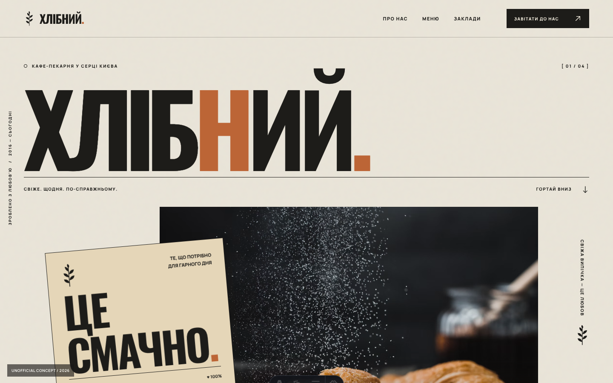
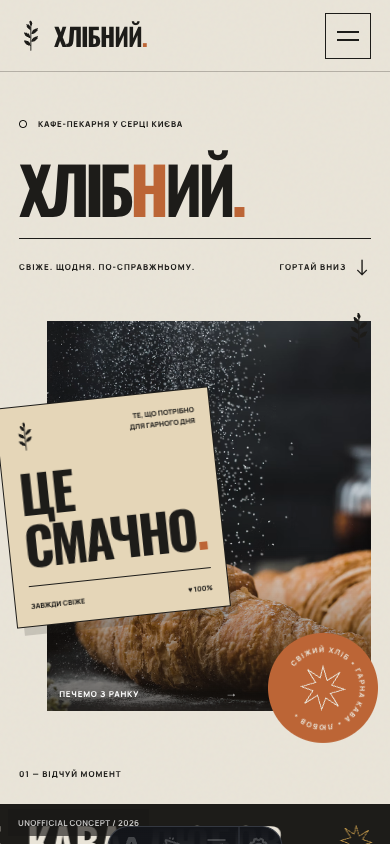

# ХЛІБНИЙ — интеграция 27.10.2026

Статус: готово локально, не опубликовано. Источник: Downloads/khlibnyi-codex-package/khlibnyi-reference-astro. Исходный пакет не изменялся.

## Что перенесено

Создан apps/khlibnyi, Astro 7.3.x / Node >=24, lockfile. Исходные Homepage.astro, styles.css, app.js и SVG сохранены. Исправлены BASE_URL у стилей, скрипта, favicon, data-fallback; preview.html исключён из публичного приложения. Добавлены noindex/canonical/OG. Скрытое мобильное меню получает inert, чтобы его ссылки не попадали в Tab-порядок.

Порт 4333 выбран потому, что 4332 занимает Falkenried; это допускается ТЗ. Приложение добавлено в DEMO_APPS. CI уже устанавливает приложения из общего реестра. Карточки/описания DE/EN/RU, категория food, три превью и третье место в JSON порядка. Eichenhain остаётся последним.

Сторонние фотографии остались hotlink, не скачивались. Лицензии не подтверждены; примечание об unofficial concept сохранено. При отключении внешних изображений все 8 картинок переключились на локальные SVG. При реальной коммерческой работе фотографии нужно заменить согласованными материалами.

## Что проверено

- PASS: отдельные dev/build, корневая сборка 12 приложений, 35 Node-тестов, SEO output, diff --check.
- PASS: root http://localhost:4333/ и subpath http://127.0.0.1:8762/astro-portfolio/demos/khlibnyi/. CSS, JS, favicon и все data-fallback находятся под subpath; локальных 404 нет.
- PASS: фильтры выпечка 2 / кофе 1 / десерт 1, мобильное меню/Escape/focus, reduced motion, loader/reveal и исходные CSS-анимации, fallback при недоступных hotlink-фото. JS runtime-ошибок в проверенных сценариях нет. Ошибки заблокированных запросов во время намеренного offline-теста ожидаемы.
- PASS: 320/390/768/1024/1440 px без горизонтального overflow; food-фильтр портфолио показывает одну карточку на DE/EN/RU, изображения карточек доступны.
- Не проверено: реальные устройства, Lighthouse/CWV, полный typecheck/lint (не настроены). Дизайн не заменялся другим концептом. Figma-файл нового кафе в этой задаче не создавался.

## Изменённые файлы

- apps/khlibnyi/README.md, astro.config.mjs, package.json, package-lock.json.
- apps/khlibnyi/src/components/Homepage.astro, src/pages/index.astro.
- apps/khlibnyi/public/app.js, styles.css, assets/{bread,coffee,croissant,dessert,favicon,interior}.svg.
- apps/portfolio/src/data/{projects.ts,project-presentation.ts,project-order.json}; i18n/translations.ts; components/PortfolioPage.astro.
- apps/portfolio/public/previews/khlibnyi{,-mobile,-tablet}.png.
- scripts/projects.mjs, README.md, docs/PROJECT_ORDER.md, docs/briefs/CODEX_TASK_KHLIBNYI.md, docs/TASKS.md, этот отчёт и скриншоты.

## Ссылки

Локально: http://localhost:4333/ . После отдельного разрешения на push и успешного GitHub Actions deploy: https://girda.github.io/astro-portfolio/demos/khlibnyi/ . Наличие URL в отчёте не означает, что сайт уже опубликован.

