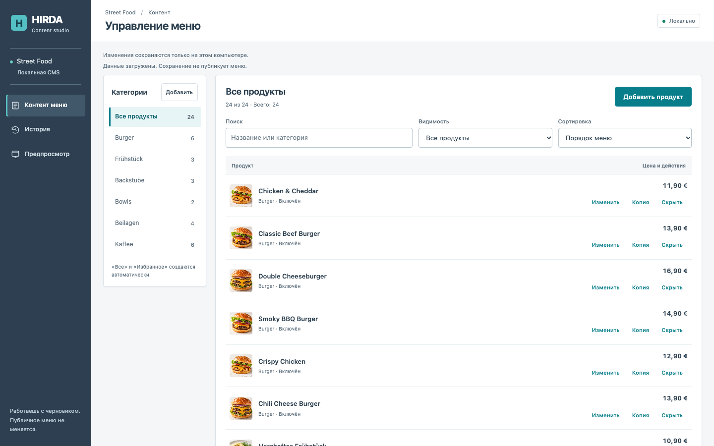
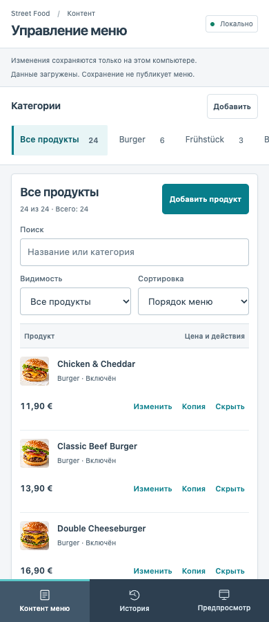
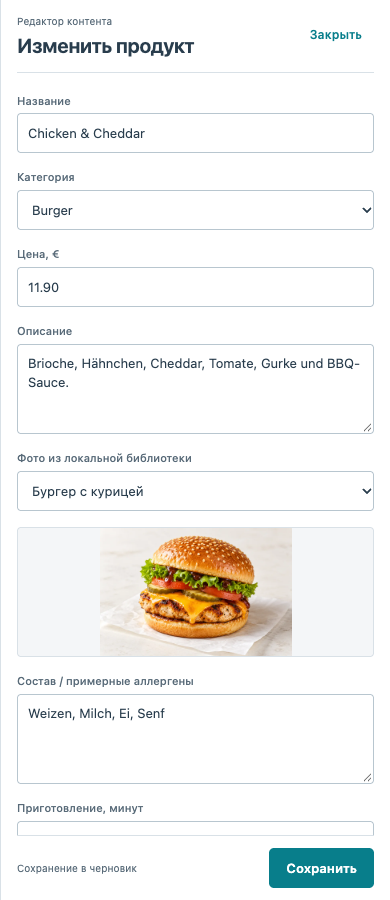
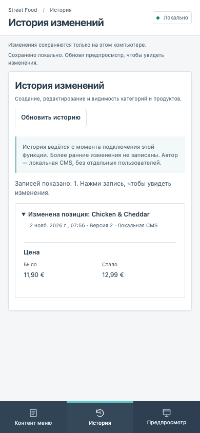

# CMS: компактный интерфейс и история · 02.11.2026

## Реализовано
По поручению Артёма заменён дизайн Material 3. Изучен пользовательский референс https://blog.hubspot.com/hubfs/content-management-system-examples-4-20251203-4306832.webp в браузере. Использованы тёмная боковая навигация, нейтральные белые панели, бирюзовый акцент и плотная компоновка. Большой вступительный экран удалён. На телефоне нижнее меню, категории со свайпом до краёв, компактные действия и полноэкранный редактор. Используются локальные HTML/CSS/JS, без внешних ресурсов и новых зависимостей.

История хранит полные снимки до/после в SQLite. Запись атомарна с обновлением контента и версии; отвергнутые запросы не создают события. Просмотр по убыванию версий, курсорная загрузка по 30, серверный максимум 50. Указаны ограничения: нет истории прошлых правок, нет отдельных авторов и отката. Сервер остаётся только на loopback, без нового публичного endpoint.

## Проверено
- npm test: 78/78, включая 4 новых теста: сохранность снимков после перезапуска, отсутствие записей при ошибке/конфликте, пагинация, миграция существующей базы без пересева, параметры API и Origin.
- node --check: admin.js, store.mjs, server.mjs.
- Эмуляция 320/390/768/1024/1440 px: нет горизонтального переполнения. В узком редакторе нет переполнения, Escape возвращает фокус, видимый фокус поля сохранён, reduced-motion учтён.
- На изолированной SQLite :memory: / порт 8792: редактирование цены, сохранение, копирование, скрытие, поиск, фильтрация и сортировка; защита несохранённого черновика.
- История в браузере: пустое состояние; цена 11,90 → 12,99; видимость Да → Нет; раскрытие изменений; 30 → 33 записи через «Показать ещё»; ошибка 503 и успешный повтор. Ошибок JavaScript в основном проходе не было.
- Рабочий сервер 8790 перезапущен после проверки процесса. Перед обновлением создана консистентная приватная SQLite-копия, Git её игнорирует. Хеш категорий/продуктов/metadata до и после совпал: 6 категорий, 24 продукта, версия без изменения; история пока пуста. На рабочем интерфейсе тестовые записи не создавались.

## Границы
Проверка выполнена в эмуляции, не на настоящем телефоне; это не сертификация доступности. У CMS нет отдельного build. Полная сборка публичных Astro-приложений не запускалась: их код не менялся. Публикация контента, загрузка изображений и серверный доступ из интернета вне задачи. Figma не обновлялась.

## Доказательства

