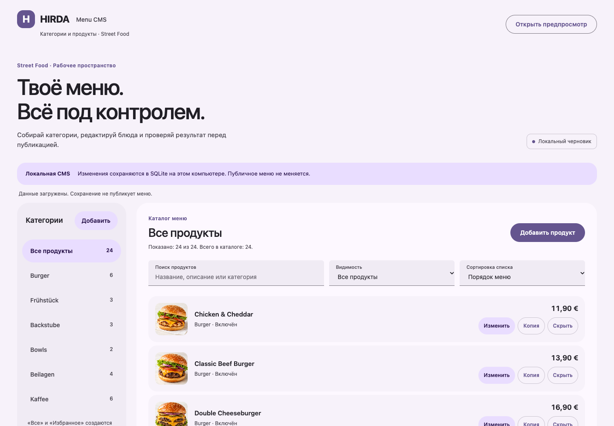
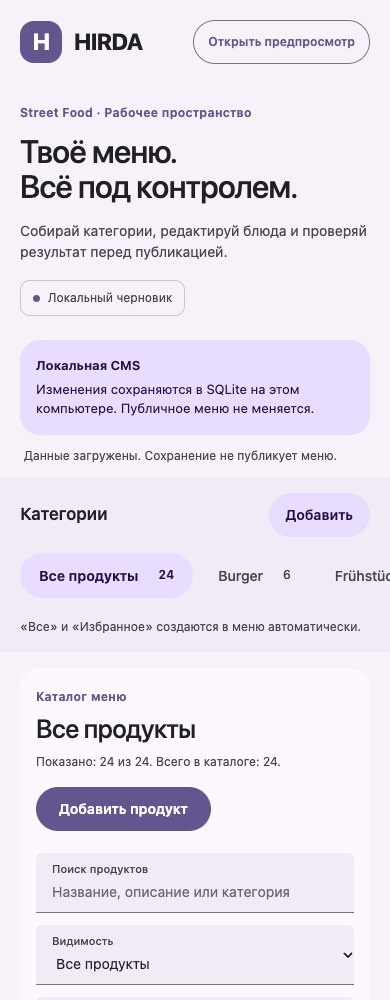
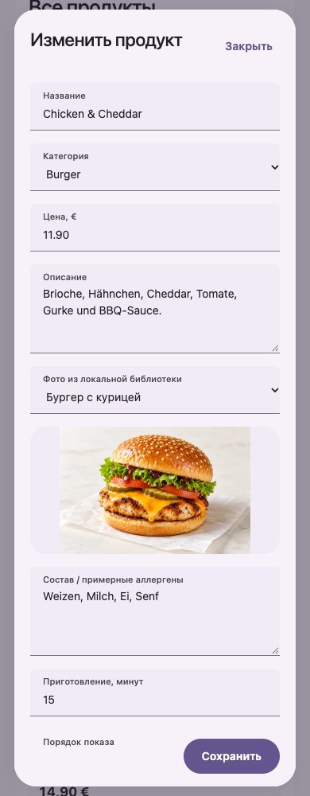

# Локальная CMS · Material 3 · 01.11.2026

По поручению Артёма обновлён дизайн существующей CMS. Референсы: https://m3.material.io/, https://m3.material.io/styles/color/the-color-system, https://m3.material.io/styles/typography/applying-type. Использованы роли цвета, тональные поверхности, типографическая иерархия, выбранная категория и filled fields. Это собственная CSS-реализация принципов, не официальная компонентная библиотека. Сервер, API, SQLite, сценарии сохранения и защита черновика сохранены. Подписи полей обёрнуты в span; доступные имена сохранены. Figma в этот этап не входила.

## Пройдено
- node --check apps/menu-cms/public/admin.js.
- npm test: 74/74.
- Эмуляция 320, 390, 768, 1024, 1440 px: нет горизонтального переполнения, доступны все 24 начальных продукта.
- Изолированный сервер 8792, SQLite :memory:: редактирование/сохранение, поиск, фильтр скрытых/видимых, копирование (24 → 25), создание категории и её автоматический выбор.
- Отказ от закрытия сохраняет черновик, подтверждение закрывает редактор.
- Редактор 320/768 px: без горизонтального переполнения; Escape возвращает фокус на кнопку открытия; фокус поля виден через цвет и подчёркивание; reduced-motion отключает переходы.
- В CRUD-проходе ошибок JavaScript не было. Рабочая CMS 8790 доступна; тесты не изменяли её базу.

## Границы
У plain HTML/CSS/JS CMS нет отдельной сборки; сборка соседних публичных приложений не запускалась для restyle админки. Это браузерная эмуляция, не физический телефон и не сертификация WCAG. Сетевой доступ, публикация из CMS и загрузка фото вне этапа.

## Превью

