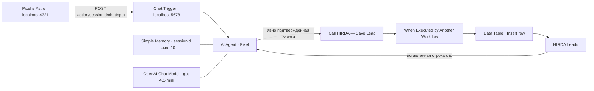

# Pixel — реальные проверки n8n

Начало: 23.10.2026. Результат обновлён: **24.10.2026, Europe/Berlin**.

Статус: **24.10.2026 по подтверждению Артёма применён Publish локального workflow** — версия `Pixel — lokale Wissensbasis 2026-10-24`, интерфейс n8n показывает Published. Действующий webhook проверен через Pixel на `http://localhost:4321/`, без mocks. GitHub Pages не менялся.

## Проверенная архитектура



Фактически Memory подключена к AI Agent, sessionId берётся из Chat Trigger; связанного внешнего хранилища диалогов нет. Chat Trigger: Embedded Chat, CORS `http://localhost:4321`, ответ последнего узла. Секрет OpenAI хранится в n8n Credentials; ключи не экспортировались и не копировались в frontend.

`Save Lead` содержит два узла: вход с name/contact/business/requirements/budget и вставку в `HIRDA Leads` со status=new. Это локальная таблица n8n, не отдельный PostgreSQL-сервис и не отправка сообщения Артёму.

## Что исправлено

- В прежних инструкциях отсутствовали Lindenhof, Eichenhain и актуальные цены.
- Добавлен генератор `apps/assistant-api/n8n-knowledge.mjs`. Прайс читается из того же `pricing.json`, который использует сайт; проекты и номер WhatsApp — из существующих config/data-модулей.
- Реальный тест выявил путаницу автосалона и автосервиса. В общий `projects.ts` добавлены отрасли из существующих публичных подписей карточек. Теперь модель получает не только имя и URL, но и category.
- Добавлены правила коротких ответов, одного уточнения, разделения консультации и ролевого демо, явного согласия перед сохранением, отсутствия выдуманных действий и повторных записей.
- Публичный API, .env, модель, credentials, CORS, структура Save Lead, HTML/CSS/анимации Pixel не менялись.

## Реальные результаты, не mocks

| Проверка | Результат |
|---|---|
| Цены Landingpage и KI-Assistent | Названы **ab 490 €** и **ab 790 €** |
| Подбор примеров | Автосалон → LINDENHOF `/demos/lindenhof/`; экодома → EICHENHAIN `/demos/ecohomes/` |
| Заявка до согласия | Показана сводка и вопрос о сохранении; инструмент не вызван |
| Сохранение после явного подтверждения | Save Lead выполнен за 73 ms, вернул строку **id=2**, status=new |
| Сверка с таблицей | Строка id=2 действительно существует; Total вырос с 1 до 2 |
| Повторный вопрос «Какой бюджет?» | Ответ **790 Euro** из памяти; Save Lead повторно не вызван; в таблице по-прежнему Total 2 |

Тестовые данные: `Pixel QA 2026-10-23`, `pixel-qa-20261023@example.com`, Gartenpflege, четыре страницы и контактная форма, бюджет 790 Euro. Имя отражает дату начала теста; строка создана 24.10.2026 в 00:50:54 Europe/Berlin. Реальному клиенту ничего не отправлялось; тестовая запись оставлена для проверки, ничего не удалялось.

Модель — существующая gpt-4.1-mini. Успешные ответы в проверенных запусках занимали около 1–4 секунд. Это наблюдение нескольких тестов, не гарантия скорости или качества каждого ответа.

## Память и ограничения

Во время паузы более двух часов Simple Memory потеряла предыдущие сообщения: подтверждение без повторения контактов привело к запросу имени/контакта заново. В следующем коротком диалоге память работала и верно вернула бюджет. Перезапуска контейнера за время проверки не было. Upstream-реализация Simple Memory очищает неактивные буферы примерно после часа; это оперативная память, не долговечная история диалогов. Сохранённая таблица заявок — отдельное хранилище.

Согласие и отсутствие дублей пока контролируются инструкциями модели, **не серверным проверяющим условием**: существующий Save Lead вставляет переданные поля напрямую. Проверенный диалог не является доказательством невозможности prompt injection, дублей, неверных данных или злоупотребления. До внешнего запуска нужна отдельная доработка валидации, подтверждения, идемпотентности и ограничений доступа. Сейчас локальный n8n не выставлялся наружу.

Корзина и быстрые варианты не появляются автоматически из текстового output. В этом этапе они не добавлялись. Четыре полноценные визуальные демо-сценария и долговечная память требуют следующего согласованного этапа.

## Код и воспроизведение

```sh
# Из корня astro-portfolio, Node 24
node scripts/export-pixel-prompt.mjs > /private/tmp/pixel-system-message.txt
npm test
```

Вывод генератора вставляется в **AI Agent → Options → System Message**. После изменения прайса/каталога генератор нужно запустить снова и обновить черновик workflow: автоматической синхронизации с n8n нет.

Сначала проверить в Open chat черновика, затем отдельно применить Publish к локальному workflow. При необходимости исходный JSON сохранён в локальной рабочей папке `pixel-workflow/backups`; он не добавлялся в репозиторий. Нельзя импортировать его вслепую поверх новых пользовательских изменений.

Проверки кода после изменений: **22 теста прошли**, `node --check` прошёл, production-сборка портфолио с Pages base прошла. Старое предупреждение о JS-чанке >500 kB осталось. Полный typecheck/Lighthouse не запускались.

## Проверка после локального Publish

Через существующий интерфейс Pixel отправлены два настоящих POST-запроса в активный `/webhook/…/chat`; оба вернули HTTP 200 и JSON с output. Первый ответ: Landingpage ab 490 €, KI-Assistent ab 790 €, корректная ссылка на LINDENHOF для автосалона. На следующий вопрос модель вспомнила рекомендованный проект и отрасль. После Enter фокус оставался в поле ввода. Подмены сетевых ответов отключены; новые тестовые заявки на этом шаге не создавались.

Доказательство в локальной рабочей папке: `pixel-workflow/active-pixel-proof.png`. Перезапуск Astro или n8n не потребовался.

## Следующий шаг

Согласовать серверное подтверждение и валидацию заявки, защиту от повторной записи и постоянную память перед внешним запуском. Дизайн чата сохраняем.

## Источники

- [n8n Workflow Tool](https://docs.n8n.io/integrations/builtin/cluster-nodes/sub-nodes/n8n-nodes-langchain.toolworkflow/) — вызов другого workflow и получение его результата.
- [n8n Data tables](https://docs.n8n.io/build/work-with-data/data-tables.md) — локальные таблицы внутри проекта.
- [n8n Simple Memory](https://docs.n8n.io/integrations/builtin/cluster-nodes/sub-nodes/n8n-nodes-langchain.memorybufferwindow/) и [исходник буфера](https://github.com/n8n-io/n8n/blob/master/packages/@n8n/nodes-langchain/nodes/memory/MemoryBufferWindow/MemoryBufferWindow.node.ts) — ограничения и очистка памяти. Upstream-код не является гарантией совпадения каждой установленной версии.
