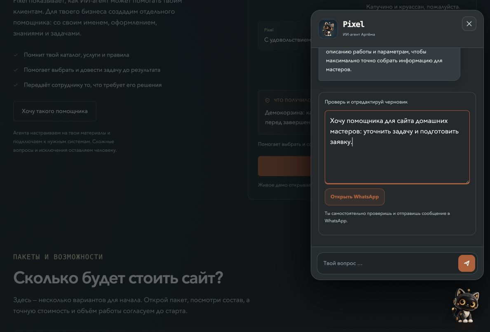

# Pixel: приёмка сценариев, 29.10.2026

Среда: публичная https://girda.github.io/astro-portfolio/ru/, Chrome, настоящий Worker/OpenAI и Invisible без обхода защиты. До обновления Worker: cb02f253-d996-4a49-a888-6c09fd2cbbf6. Это выборочные сценарии, не гарантия всех ответов модели.

| Проверка | Результат |
|---|---|
| Кафе: cappuccino + croissant | До ответа об аллергиях корзина пуста. После «Нет, добавить» — 2 позиции, €6,70 |
| Изменение количества | Ещё один кофе: €10,60; уменьшение: €6,70. Реального заказа/оплаты нет |
| Авто: до €30 000, автомат | **Ошибка:** кроме Touring €28 900 предложен Family SUV €34 900, добавлены неизвестные характеристики |
| Авто: черновик тест-драйва | Touring перенесён в черновик; настоящая запись не заявлена. В RU пришли немецкие кнопки |
| Мастер: телевизор 55 дюймов, стена неизвестна | Подготовлен черновик с известной задачей; материал оставлен для проверки. После подтверждения вопросы остановились |
| Реальный интерес к агенту → обращение | Задача владельца фирмы отделена от вымышленного телевизора. Черновик доступен для редактирования |
| Редактирование обращения | WhatsApp href содержит изменённый текст. Внешняя ссылка не нажималась, сообщение не отправлялось |

## Исправления в коде
- Усилены инструкции авто: совместно учитывать бюджет и коробку, не предлагать неподходящие авто, не придумывать характеристики. Это инструкции модели, **не детерминированная фильтрация каталога**.
- Стандартные действия подтверждения локализуются отдельной чистой функцией; та же подпись отправляется при нажатии.
- `Total` заменён локализованным `Итого` в RU.
- Локальная браузерная проверка с HTTP-фикстурой на 320 px: RU-кнопки, отправка «Всё верно», «Итого», без переполнения. Это не настоящий ответ AI.

Проверки изменений: npm test — 61/61; общая сборка 13 приложений успешна; Wrangler dry-run успешен. Проверка инструкций в тесте не доказывает соблюдение бюджета моделью.

## Осталось
Исправление Worker согласовано пользователем 29.10. При попытке публикации `wrangler whoami` сообщил об истёкшем OAuth и невозможности обновления. Запущен повторный login; нужен вход пользователя. После deploy повторить запрос «до 30 000 €, автомат» и подтвердить, что подходит только Touring. Не объявлять автосценарий принятым раньше проверки. Полная проверка аллергенных веток, реальный WhatsApp send и устройства iOS/Android в этот этап не входят.

